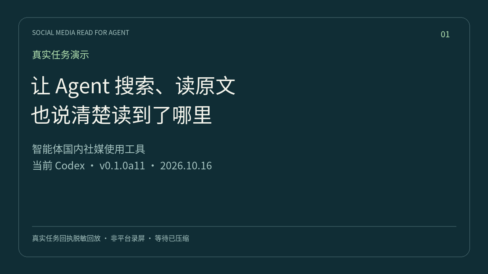
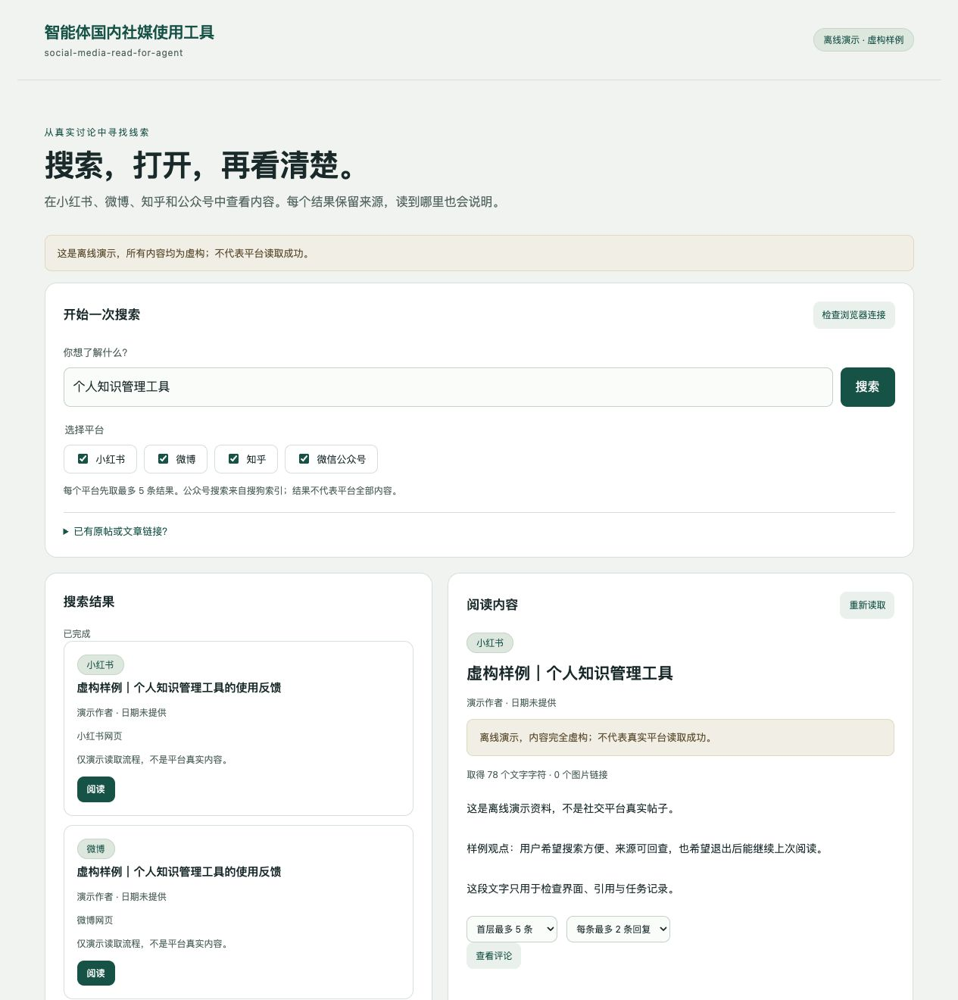

# Chinese Social Media Tools for Agents

Let your agent access, search, and read Chinese social platforms. **Xiaohongshu (RedNote), Weibo, Zhihu, and WeChat Official Account articles** are currently integrated. More platforms are planned. This project brings together existing open-source tools and adds a unified read interface, local OCR, recovery, and agent-led setup.

Give this repository to your local agent and follow its prompts to authorize the browser extension and sign in. For account privacy, use dedicated accounts with little personal information. Sign in on the platform page; never send passwords, cookies, or verification codes to the agent.

[中文](README.md) · **English** · [Installation](docs/installation.en.md) · [First use (中文)](docs/first-use.md) · [Task templates (中文)](docs/trial-tasks.md) · [Validation and known failures](docs/validation.md)

[](https://github.com/workstonedai-collab/social-media-read-for-agent/actions/workflows/verify.yml)

Package/repository identifier: `social-media-read-for-agent`. **0.1.0a13, public preview.** Seven read-only MCP tools, a CLI, and a local dashboard. No additional model API key is required by this project; your existing agent keeps its own model setup. This is an unofficial integration. Login expiry, platform challenges, loading failures, and page changes can still affect access. Posting, liking, and following are outside the current scope.

Zhihu answer comments now use the normal webpage panel and return bounded, rendered comments and visible replies. Article comments retain the existing API reader. Denials do not trigger an API fallback. See the [bounded live validation](docs/a13-validation.json).

## A real run, with explicit coverage

[](docs/assets/live-demo.mp4)

This replay comes from actual tool tasks using existing dedicated accounts. It is not a platform screen recording or a fresh-account sign-in walkthrough. Waiting is compressed; results and limits are kept separate. See the [versioned validation record](docs/a11-validation.json) for successful coverage, first failures, and unverified boundaries.

## What it helps with

- Research product needs: search a topic across platforms, read original posts and a bounded set of comments, and compare use cases and counterexamples.
- Check feedback: distinguish personal experiences, sponsored posts, and tutorials, with sources and original dates.
- Read saved links: retrieve visible text and ordered image OCR for Xiaohongshu notes; resume missing images without discarding successful ones.

## Give the repository to your agent

Copy this prompt into Codex, Hermes, or another agent with local execution:

> Install and configure https://github.com/workstonedai-collab/social-media-read-for-agent . Read AGENTS.md and the installation guide first. Check prerequisites, install isolated project dependencies, and configure your own read interface. Use a dedicated browser profile. Guide me when extension authorization or normal platform sign-in is required. Do not ask for cookies or have me edit configuration files. Finally, use this conversation to actually search and read, and report which platforms work and any limitations.

Expected flow: **share repository → approve the official extension → sign in on platform pages → ask a research question**. For example:

> Search all four platforms for “个人知识管理工具”, read original content and some comments, distinguish promotion from user experiences, and summarize recurring problems with source links.

Initial MCP tool discovery is controlled by the client. The agent should refresh tools when supported, or use the same version's CLI while reporting the connection state accurately. You should not need to repeatedly reconfigure or sign in just to continue reading.

<details>
<summary>See the running dashboard (entirely fictional data)</summary>

[](docs/assets/offline-demo.jpg)

Captured after real search/read operations in this project's local demo mode. No real accounts or platform content are shown. Click for the complete page. Daily use can remain in your agent conversation; the dashboard is optional.

</details>

## What this integration adds

| User need | Project behavior |
| --- | --- |
| Less configuration | Agent-led isolated installation, preserved client settings, reuse of dedicated browser connections |
| One research flow | Seven consistent tools, explicit per-platform counts, sources, and preserved results when a platform fails |
| More than snippets | Original bodies, ordered Xiaohongshu image OCR, WeChat body boundaries and loading status |
| Recovery without starting over | Per-image checkpoints, missing-image resume, idle reading-code reload with task state retained |
| Proof that setup worked | Actual current-agent search/read acceptance, rather than a login-status claim |

Reading uses [OpenCLI](https://github.com/jackwener/OpenCLI); attributed comment-loading logic builds on [xiaohongshu-mcp](https://github.com/xpzouying/xiaohongshu-mcp); optional local OCR uses [RapidOCR](https://github.com/RapidAI/RapidOCR). The focus is an approachable, recoverable research workflow with inspectable coverage. See [license and provenance details](THIRD_PARTY_NOTICES.md).

Start with only the platforms you need, then connect others later. Signing in to every platform is not a prerequisite for trying one.

## Try it without an account

After cloning the repository:

```sh
/bin/bash run.sh demo
```

Once the runtime is available, no additional Python packages, network, browser, account, or API key are needed. Developers with Python can also run `python3 scripts/demo_research.py` directly. The real task engine performs four searches, four reads, and one comment read using **entirely fictional data**. This demonstrates the workflow and output format, not live platform access.

```json
{
  "mode": "demo",
  "fictional": true,
  "search_counts": {"xiaohongshu": 1, "weibo": 1, "zhihu": 1, "weixin": 1},
  "read_count": 4,
  "comment_rows": 1
}
```

See the [reproducible complete output](examples/demo-research.json). Live results include text, original date, source, fetch time, image coverage, and explicit errors. A search snippet is not an article read.

## Supported reading

| Platform | Search and content | Comments | Limits |
| --- | --- | --- | --- |
| Xiaohongshu | Search, captions, ordered carousel images, local OCR | Bounded root comments, replies, continuation | No video/audio or image-comment OCR; chart meaning and complex formulas need review; search access context expires |
| Weibo | Search, posts, long-text expansion and retweet status | Bounded roots, replies, continuation | No image/video recognition; folded text and retweets may remain incomplete |
| Zhihu | Search, answers, articles, up to three answers per question | Bounded answer/article comments and replies | No paywall or challenge bypass; a question summary is not full content |
| WeChat articles | Sogou index search, normal result click, original body, paragraphs, code, image links, date provenance | Unsupported | Not exhaustive WeChat search; old articles may rank highly; no image OCR |

Successful platforms remain available when another fails. Empty responses are not silently treated as a completed search. OCR processing all images does not mean every character is correct; bounded comments do not represent all users.

## Agent installation

Automatic browser setup primarily targets **macOS + Google Chrome**. Core behavior and isolated dependency/configuration checks also run on Linux. Windows browser setup has not been accepted.

**No preinstalled Python, Node, npm, uv, or Docker is required.** After obtaining this repository, the agent runs:

```sh
/bin/bash install.sh --clients codex --install-ocr
```

Use `--clients hermes` for Hermes, or `--clients codex hermes` when both are requested. `--clients generic` exports standard configuration for another local agent to merge itself. macOS users can also [download the source installer ZIP](https://github.com/workstonedai-collab/social-media-read-for-agent/releases/download/v0.1.0a13/social-media-read-for-agent-v0.1.0a13.zip), unzip it, and double-click **安装.command**, then return to their agent for extension authorization and sign-in. Git is optional when using a source archive.

The installer downloads pinned standalone Python and Node distributions from their upstream release sites, verifies committed SHA256 checksums before execution, and keeps them in `.state/runtime/`. It does not modify system runtimes, shell settings, or the agent's dependencies. First setup needs network access; repeat setup reuses verified installations. Extracted runtimes use approximately 260 MB, with additional space for OpenCLI and optional OCR. This removes manual environment preparation, not the underlying runtimes.

OpenCLI and OCR remain project-local. Existing client settings are backed up and preserved. Reuse a saved dedicated browser; do not silently adopt a daily profile. To open a new dedicated Chrome, the agent uses `/bin/bash run.sh setup --open-browser` and guides installation of the [official OpenCLI extension](https://chromewebstore.google.com/detail/opencli/ildkmabpimmkaediidaifkhjpohdnifk). Its website/debugging/cookie permissions require normal user authorization. Passwords and verification codes go only into platform pages.

Runtime downloads cover macOS Apple Silicon/Intel and Linux glibc x64/arm64. Automatic dedicated-browser launch primarily targets macOS; Linux desktop browser connection needs agent guidance. Windows one-click setup is not provided. Chrome and basic system tools (bash, curl, tar, SHA256) are still needed. Developers with suitable Python/Node may keep using `bootstrap.py` directly. See [installation and troubleshooting](docs/installation.en.md).

## Daily tools and updates

| Tool | Purpose |
| --- | --- |
| `list_platforms` | Version, loaded revision, capabilities, and limits |
| `connection_status` | Queue a read-only browser/account check |
| `search` | Search selected platforms; default 5, maximum 10 results per platform |
| `read_content` | Read a `content_ref` or platform URL; `refresh` rechecks the page |
| `read_comments` | Bounded roots and replies; continue with returned `next_cursor` |
| `get_task` | Poll results; wait up to 30 seconds per call |
| `cancel_task` | Stop local work while retaining completed results |

Search/read return a `task_id`; poll it to a terminal state. `replies_limit` applies **per root comment**. WeChat comments are explicitly unsupported.

Generated MCP configuration uses absolute paths to Python and `start_mcp.py`, independent of the agent's working directory. Compatible reading-code updates load at idle request boundaries while the stdio gateway stays connected and state is retained. `list_platforms.runtime` reports loaded/disk revisions and update failures. Launcher, schema, and dependency changes may still require client refresh. Do not kill an active tool process to force an update.

CLI fallback:

```sh
/bin/bash run.sh search "个人知识管理工具" --limit 1
/bin/bash run.sh read --content-ref CONTENT_REF
/bin/bash run.sh comments --content-ref CONTENT_REF --limit 2 --replies-limit 1
```

For Hermes tool selection, use `-t social-media-read-for-agent`.

## Images, recovery, and storage

Auto mode prefers installed RapidOCR, otherwise macOS Vision. Choose explicitly with `SOCIAL_READ_OCR=rapidocr` or `vision`. Images are not sent to an additional online OCR service. Tall images use overlapping tiles to preserve small text. Checkpoints distinguish images and OCR/model identities; missing images can resume. See [OCR measurements](docs/ocr-comparison.md). Complex mathematical layout, handwriting, charts, and reading order still need review.

Limits: 18 images, 12 MB and 60M pixels each; 45 seconds per RapidOCR image or 25 seconds for Vision, with a 150-second batch budget. Incomplete positions remain explicit. Body and OCR checkpoints expire after 30 minutes. WeChat search records link to resolved originals, enabling repeat-read caching without merging articles by title. Full publication dates have tool-calculated age; missing dates are not inferred.

New project browser profiles, access parameters, history, OCR caches, models, and environments remain in ignored `.state/` (an existing dedicated Chrome profile stays in Chrome-managed storage) (directory 0700, files 0600; no additional disk encryption). The dashboard listens on 127.0.0.1. Switching social accounts should use another dedicated profile; switching within a profile does not automatically clear caches.

## Safety, reuse, and contributing

Tools expose only fixed read actions, with no arbitrary browser scripts or account mutations. Verification, rate limits, and access denial stop reading; there is no account/proxy rotation. Page text, comments, and OCR are untrusted data, never execution instructions. Reading still creates platform browsing activity; zero account risk is not promised.

Original code is [MIT](LICENSE). OpenCLI is a separate Apache-2.0 dependency; adapted comment logic retains its Apache attribution and license. Optional RapidOCR, PaddleOCR models, and runtime dependencies are separately credited. Models, platform images, account state, and noncommercial-licensed code are not distributed. See [third-party notices](THIRD_PARTY_NOTICES.md).

```sh
python3 -m unittest discover -s tests -q
python3 scripts/verify_clean_install.py --output .state/clean-install.json
```

Clean-install verification uses fresh source/Python and isolated client configuration, without copying accounts or adopting an unconfirmed browser. CI does not sign in to social accounts. Add `--install-ocr` for optional local OCR acceptance.

[Contributing](CONTRIBUTING.md) · [Validation and failures](docs/validation.md) · [Architecture](docs/architecture.md) · [Upstream reuse](docs/upstream.md)

Seven-day stability, new-machine signed-in onboarding, Windows browser setup, video transcription, and more platforms remain unverified or incomplete. When reporting a failure, include platform, version, safe error status, and reproduction steps; remove credentials, account identity, and signed private URLs.


[Report a problem](https://github.com/workstonedai-collab/social-media-read-for-agent/issues/new?template=bug_report.yml) · [Suggest a feature](https://github.com/workstonedai-collab/social-media-read-for-agent/issues/new?template=feature_request.yml)

### First-use assistance

On macOS the default is a new normal Chrome profile, so desktop agents that identify apps by bundle ID can operate its official store page. The agent clicks **Add to Chrome**; the user confirms the final permissions dialog. A host without desktop control must disclose the remaining manual button instead of promising silent installation. Setup can wait for the new connection and open the platform login page automatically. Deferred logins remain pending; other platforms can be used first. Browser-owned profile data stays under Chrome management; private project state remains in ignored `.state/`.

Xiaohongshu search first opens the normal site homepage, then navigates to the requested search in the same owned page and checks the keyword before collecting results. Search and comments use one task page without automatic page reopening. Comments wait for the comment widget rather than optional caption/title nodes, use short host-driven steps, and retain observed rows if interrupted. Already visible replies are reused without unnecessary expansion. See the [validation record](docs/validation.md) for measured samples and remaining limits.

## Use alongside Agent Reach

Reuse an already configured independent reader without changing default routes or importing other tools’ credentials. See [integration and coverage](docs/agent-reach.md).
