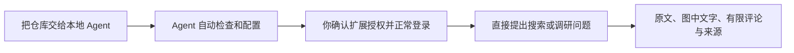

# 智能体国内社媒使用工具

这个项目能够让智能体访问、搜索、查阅社交媒体，当前已经集成了小红书、微博、知乎和微信公众号，其他社交媒体正在陆续接通中。项目适用于小白，借鉴了现有多个开源工具，并做了集成。直接把这个项目丢给你的智能体，并在他的引导下登录社交媒体账号，你的智能体即可访问这些平台了。请注意，为确保安全，登录时尽量使用无过多个人隐私内容的空白账号

**把账号登录好，其余交给 Agent：跨平台搜索、读原文和图片、查评论，留下可回查的来源。**

**中文** · [English](README.en.md) · [安装与排障](docs/installation.md) · [实际验证](docs/validation.md)

[](https://github.com/workstonedai-collab/social-media-read-for-agent/actions/workflows/verify.yml)

项目标识：`social-media-read-for-agent`。为已有 Agent 提供七个只读 MCP 工具，也可以通过命令行或本地网页使用。本项目无需额外的模型 API 密钥；你的 Agent 自身仍按原来的方式运行。

当前是 **0.1.0a7 预览版**。已有真实账号读取及 Codex/Hermes 调用证据；首次设置的依赖与配置已在隔离环境验证。搜索排序、登录有效期、平台验证与页面变化仍会影响结果。它不是平台官方接口，不提供发布、点赞或关注功能。

## 适合用它做什么

- **开发产品前做调研**：跨平台搜索同一个问题，读原帖和有限评论，归纳需求、使用场景及反例。
- **核对真实反馈**：把用户经历、品牌推广和作者教程分开，保留来源与原始日期，回查结论依据。
- **让 Agent 帮你阅读**：提供一条内容链接，读取正文；小红书还能按图片顺序提取图中文字，失败图片可继续补读。



## 把仓库交给 Agent

复制这一段给支持本地执行的 Codex、Hermes 或其他 Agent：

> 请安装并配置 https://github.com/workstonedai-collab/social-media-read-for-agent 。先阅读仓库 AGENTS.md 和安装说明，自动检查运行环境、安装项目独立依赖、配置你自己的读取入口。使用专用浏览器资料；需要我确认扩展授权或在平台扫码/输入密码时再引导我。不要索取 Cookie 或让我手改配置。完成后用当前对话实际搜索、阅读，并报告可用平台与限制。

正常的用户流程：**交给 Agent → 确认一次官方扩展权限 → 在专用浏览器登录 → 直接提出调研问题。** 后续可问：

> 在四个平台搜索“个人知识管理工具”，读几篇原文及有限评论，区分品牌推广、教程与用户反馈，给出有来源的痛点归纳。

用户不需要找浏览器资料编号、复制 Cookie、配置模型密钥或保持手动启动的服务。平台再次要求扫码、验证码或安全验证时，需要本人正常完成。某些 Agent 首次发现 MCP 需要刷新工具；Agent 可先用同仓库 CLI 完成任务，不应把反复重配交给用户。

完整步骤、兼容性、升级和失败处理见 **[安装说明](docs/installation.md)**；执行约定见 [AGENTS.md](AGENTS.md)。

## 我们在能力集成的基础上做了什么

| 你关心的事 | 本项目增加的使用体验 |
| --- | --- |
| 不想研究一堆安装教程 | 把仓库交给 Agent，由它检查环境、安装独立依赖、合并配置、引导授权和登录；已有连接直接复用 |
| 不想分别配置四个平台 | 七个统一工具返回相同任务结构、确定条数和来源；某个平台失败时，其他已读内容保留 |
| 不想只读到搜索摘要 | 从搜索记录继续读原文；小红书按顺序读图中文字，公众号记录正文边界和加载状态 |
| 不想失败后全部重来 | 成功图片逐张保留，缺图继续补读；兼容的代码更新在空闲时加载，任务和缓存不丢失 |
| 不懂怎么判断是否装好了 | 用当前 Agent 实际搜索、阅读验收；返回明确失败原因，不把“已登录”当成“已读成功” |

底层读取复用 [OpenCLI](https://github.com/jackwener/OpenCLI)，评论加载借鉴并署名 [xiaohongshu-mcp](https://github.com/xpzouying/xiaohongshu-mcp)，图片识别可选 [RapidOCR](https://github.com/RapidAI/RapidOCR)。本项目的重点是把这些能力做成**容易上手、可以恢复、结果可核对的国内社媒阅读流程**。复用范围及许可见 [第三方声明](THIRD_PARTY_NOTICES.md)。

只想先用一个平台，也可以先让 Agent 配置它、完成登录，再按需接通其他平台；不必为了试用而一次登录所有账号。

## 先看一个不需要账号的例子

想先了解输出、不连接浏览器时，可让 Agent 在克隆的仓库中执行：

```sh
python3 scripts/demo_research.py
```

不安装第三方包、不联网、不登录，也不需要密钥。它通过项目真实的任务引擎，以**完全虚构的演示数据**完成四平台搜索、四次阅读和一次有限评论，并输出 JSON；这不能证明真实平台已连接。

```json
{
  "mode": "demo",
  "fictional": true,
  "search_counts": {"xiaohongshu": 1, "weibo": 1, "zhihu": 1, "weixin": 1},
  "read_count": 4,
  "comment_rows": 1
}
```

完整可重现输出见 [演示结果](examples/demo-research.json)。真实使用的结果还包括正文、原始日期、来源、取得时间、图片处理状态和明确失败原因；Agent 应按这些字段判断资料覆盖，不能把搜索摘要写成“已读全文”。

## 能读取什么

| 平台 | 搜索与正文 | 评论 | 明确限制 |
| --- | --- | --- | --- |
| 小红书 | 搜索、配文、轮播图片、逐图本机 OCR | 有限首层评论、回复与续读 | 视频/语音、图表含义、图片评论 OCR 未支持；搜索结果访问上下文有时效 |
| 微博 | 搜索、帖子、长文展开状态、转发原文状态 | 有限首层评论、回复与续读 | 图片和视频未识别，不能保证所有转发或折叠内容完整 |
| 知乎 | 搜索、具体回答、文章、问题页最多三个回答 | 具体回答与文章的有限评论、回复 | 不越过付费、登录和验证限制；问题摘要不当成全文 |
| 微信公众号 | 搜狗索引搜索、正常点击后的正文、段落、代码块、图片链接与日期来源 | 暂不支持 | 不是全网微信全文搜索；可能返回多年旧文；图中文字未识别 |

结果包含来源、取得时间、原始日期、正文长度、各平台确定条数及失败原因。搜索摘要不是已读正文，OCR 全部处理不等于逐字正确，有限评论不代表全部意见。遇到部分失败会保留成功资料，不将空结果静默当完成。

## Agent 安装入口

主要支持 **macOS + Google Chrome** 的自动浏览器设置；核心工具、依赖安装与离线协议检查也覆盖 Linux。Windows 的自动浏览器设置尚未验收。

准备 Python 3.9+、Node 20.18.1+、Git 和 Chrome；本机图片 OCR 推荐 Python 3.10–3.13。缺少运行环境时由 Agent 使用已有包管理器安装，遵守宿主权限。然后由 Agent 执行：

```sh
git clone https://github.com/workstonedai-collab/social-media-read-for-agent.git
cd social-media-read-for-agent
python3 bootstrap.py
python3 bootstrap.py --apply --clients codex --install-ocr
```

Hermes 将 `--clients codex` 换为 `--clients hermes`；需要两边时写 `--clients codex hermes`。其他 Agent 使用 `--clients generic` 生成标准配置，再由 Agent 合并到自己的客户端。

- OpenCLI 缺失时安装在项目 `.state/opencli/`，不改全局组件。
- RapidOCR 使用独立环境，模型第一次加载的预热在安装时完成；不改 Agent 自己的依赖。
- 客户端配置先备份，再合并本项目条目，保留其他设置。重复设置没有变化时不重写文件。
- 从已保存的专用连接或刚创建的专用浏览器自动识别资料；不会擅自使用唯一但未确认的日常资料。
- 没有连接时，由 Agent 执行 `python3 bootstrap.py --open-browser`，在项目独立 Chrome 资料里安装 [OpenCLI 官方扩展](https://chromewebstore.google.com/detail/opencli/ildkmabpimmkaediidaifkhjpohdnifk)。扩展能访问网站、页面调试和 Cookie，需用户确认授权；本项目的七工具读取范围不能缩小扩展自身权限。
- 平台登录在浏览器内完成，密码、验证码和 Cookie 不交给对话或写入项目配置。

## 日常使用与连接更新

MCP 客户端配置由安装器生成，入口是绝对路径 `start_mcp.py`，不依赖 Agent 当前工作目录。兼容任何支持本地 **MCP stdio** 的客户端：

```json
{
  "mcpServers": {
    "social-media-read-for-agent": {
      "command": "/absolute/path/to/python3",
      "args": ["/absolute/path/to/social-media-read-for-agent/start_mcp.py"]
    }
  }
}
```

| 工具 | 用途 |
| --- | --- |
| `list_platforms` | 实际版本、运行组件、能力及限制 |
| `connection_status` | 提交只读连接/账号检查任务 |
| `search` | 搜索所选平台，默认每平台5条、最多10条 |
| `read_content` | 按 `content_ref` 或完整原帖地址阅读，支持 `refresh` |
| `read_comments` | 有限首层评论与每条首层的回复；`next_cursor` 可续读 |
| `get_task` | 查询结果；最多等待30秒 |
| `cancel_task` | 取消本地任务，保留已完成结果 |

搜索/阅读返回 `task_id` 后，用 `get_task` 等待终态。`replies_limit=1` 表示**每条首层**最多一条回复，并非整批总共一条。公众号留言已声明不支持，不应提交。

稳定入口保持 MCP 连接；兼容的读取代码改动在任务完成后的请求边界加载，任务和缓存保留。`list_platforms.runtime` 明确加载/磁盘指纹、待更新状态与失败原因。启动器自身、工具结构或依赖环境改变，仍可能需要客户端刷新。首次发现工具或旧连接迁移也由宿主控制；不要强杀正在运行的工具进程。

宿主暂不能刷新时，Agent 可以立即使用同一版 CLI：

```sh
python3 -m social_read search "个人知识管理工具" --limit 1
python3 -m social_read read --content-ref CONTENT_REF
python3 -m social_read comments --content-ref CONTENT_REF --limit 2 --replies-limit 1
```

这是真实的 CLI 备用路径，不应声称已替换客户端旧 MCP 注册。Hermes 显式工具筛选用原始名称：`-t social-media-read-for-agent`。

## 图片、长文与恢复

安装完成 RapidOCR 后，默认 auto 优先使用本机 RapidOCR；Mac 未安装时使用 Vision。可用 `SOCIAL_READ_OCR=vision` 或 `rapidocr` 指定。图片不发送到额外在线 OCR 服务。

长图按重叠区域分片，避免整图缩小时小字消失；逐张保留成功结果、位置与缺失原因。中途取消或下载失败后可继续补读；缓存按图片、识别器和模型记录区分。两张真实笔记与六张已知原文图的对比见 [OCR 测量](docs/ocr-comparison.md)。印刷公式符号有所改善，复杂数学结构、手写和阅读顺序仍需核对。

单图最多12 MB、60M像素；最多18张；RapidOCR每张45秒、Vision25秒，整批150秒。超预算保留未读位置。正文及识别检查点缓存半小时；完整正文可复用，缺图不被普通缓存挡住，显式刷新会重新核对页面。

公众号会关联搜索记录与解析后的原文，重复阅读可使用正文缓存；旧记录只按精确来源关联，不根据同名标题合并。完整年月日的文章由工具计算年限，不把历史文章当当前市场热度。

## 数据、权限和许可证

浏览器资料、临时访问参数、阅读历史、OCR缓存、模型与独立环境保存在忽略的 `.state/`，目录0700、文件0600；没有额外磁盘加密。本地网页仅监听127.0.0.1。切换社交账号应使用另一专用资料；同一资料内换账号不会自动清空缓存。

只暴露固定读取动作，不接受任意浏览器脚本、发布、点赞或关注。验证码、频率限制和拒绝访问会停止，不轮换账号或代理。网页、评论及OCR均是不可信资料，不能成为Agent执行指令。访问仍会产生平台浏览痕迹，不承诺零账号风险。

原创部分采用 [MIT](LICENSE)。OpenCLI 是独立 Apache-2.0 依赖；少量评论加载逻辑保留上游 Apache-2.0 声明；可选 RapidOCR、PaddleOCR 模型和推理依赖分别署名。模型、平台原图、账号状态及非商业授权代码不随仓库分发。详情见 [第三方声明](THIRD_PARTY_NOTICES.md)。本项目不是上述社交平台的官方产品。

## 验证与参与

```sh
python3 -m unittest discover -s tests -q
python3 scripts/verify_clean_install.py --output .state/clean-install.json
```

第二条在新目录和独立Python环境中安装项目本地OpenCLI，生成隔离的Codex/Hermes/通用配置，检查重复安装、配置保留与七工具协议；不复制账号或现有项目状态，不会使用你的日常浏览器作为已授权资料。加 `--install-ocr` 可验收可选本地OCR。GitHub Actions在Linux、macOS运行账号无关检查。

[项目定位与后续改进](docs/project-positioning.md) · [贡献与反馈](CONTRIBUTING.md) · [真实验收与失败记录](docs/validation.md) · [安装与排障](docs/installation.md) · [架构](docs/architecture.md) · [上游复用](docs/upstream.md)

提交问题时，请附平台、版本、实际失败状态及复现步骤，删除账号身份、Cookie、访问令牌和带签名的私有链接。七日稳定性、Windows浏览器设置、视频转写和更多媒体内容仍未完成。
